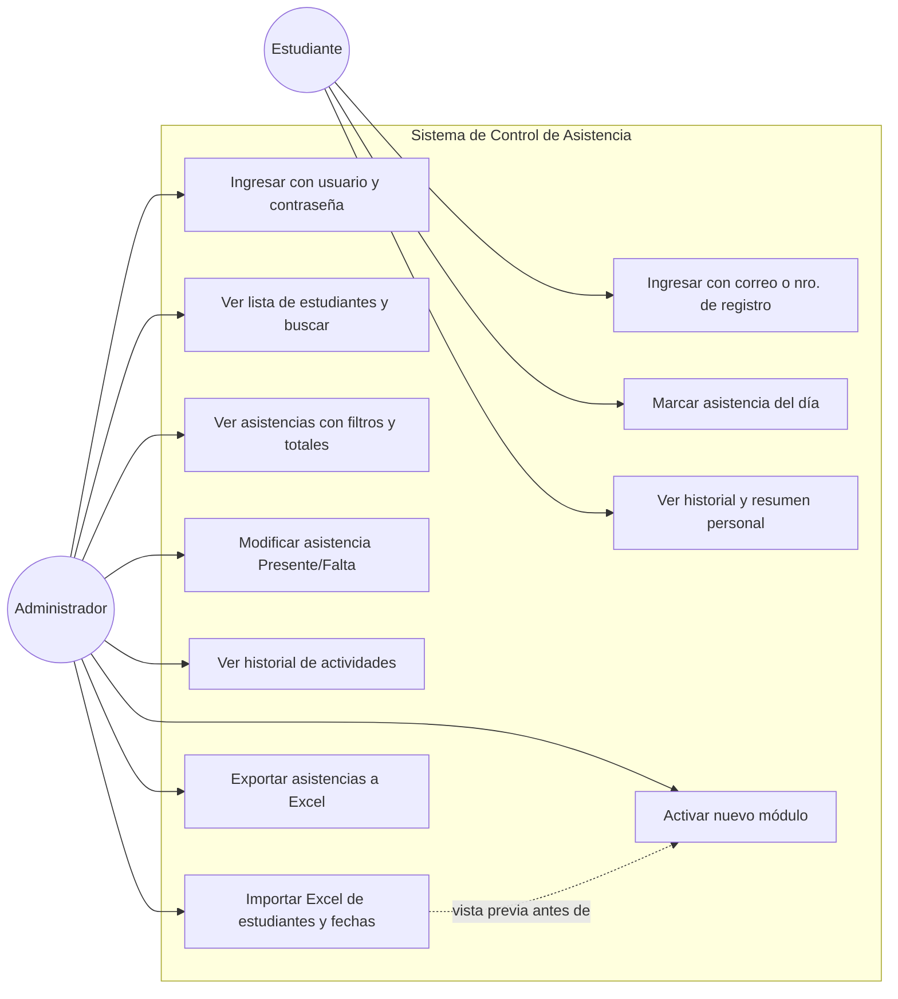
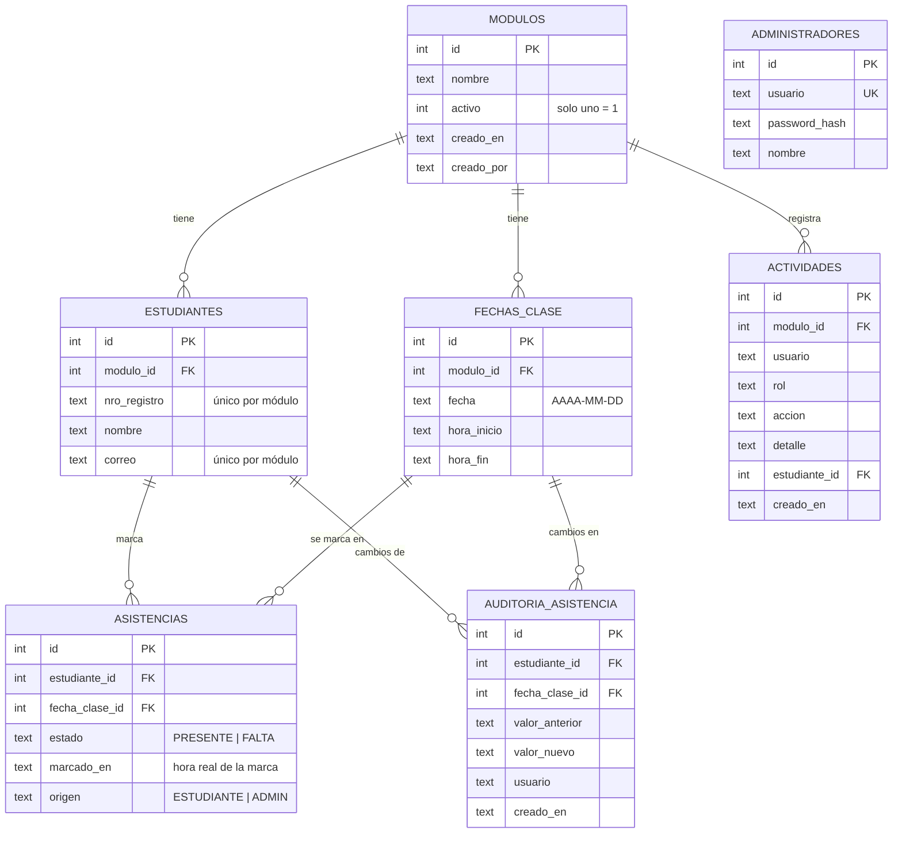
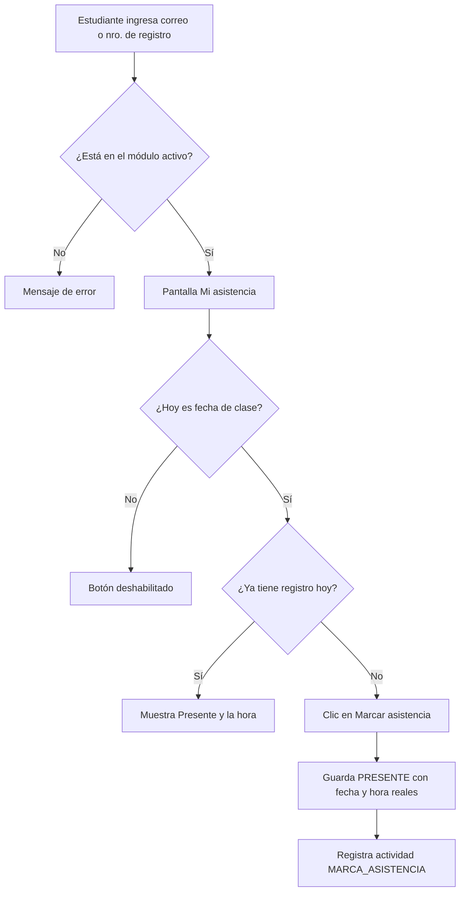
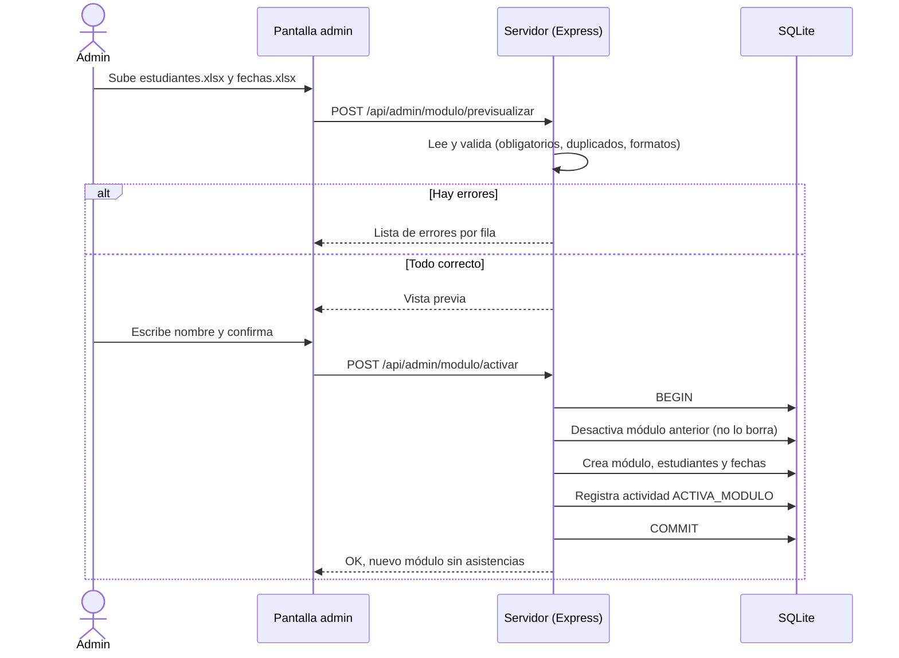
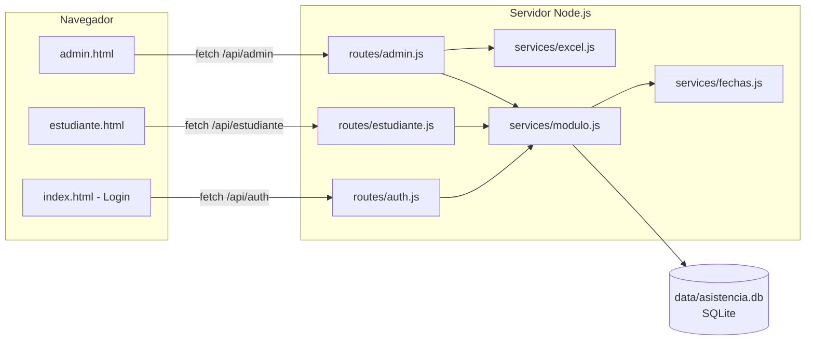

# Diagramas del sistema

Estos diagramas están escritos en **Mermaid**. GitHub los dibuja automáticamente al abrir este archivo.
En VS Code puedes verlos instalando la extensión *Markdown Preview Mermaid Support* y abriendo la vista previa (`Ctrl+Shift+V`).

## 1. Casos de uso

## 2. Modelo de datos (entidad–relación)

> La **falta** no se guarda como fila: si una fecha ya pasó y el estudiante no tiene registro, el sistema la muestra como Falta (RN-05). Solo se guarda una fila FALTA cuando el administrador la pone a mano.

## 3. Flujo: el estudiante marca asistencia

## 4. Flujo: el administrador activa un nuevo módulo

## 5. Arquitectura

